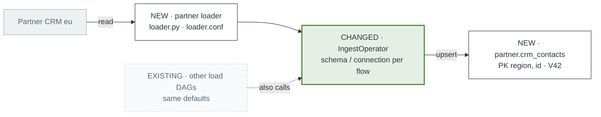

# PR bodies on GitHub

For "document my PRs / my stack": write each PR's description so a reviewer opening that one PR knows what it changes, where it sits in the stack, and what to look at. If the user normally keeps PRs title-only, this mode is the exception they asked for; use it only when they ask for PR documentation. A `gh stack submit --auto` run copies commit messages into bodies; when this mode is used, the body written here replaces that.

## Diagrams on GitHub

GitHub renders ```` ```mermaid ```` blocks inline, and PNGs would need hosting, so each body carries a small mermaid flowchart styled with the house palette. Keep it to the components of this PR plus the direct neighbours it reads from or writes to (6 nodes max). The full rendered diagrams belong in the Notion doc; link it when one exists.



Rules: status word first in each label (NEW, CHANGED, EXISTING, DELETED), real identifiers on the second line, `changed` class only on shared code that other callers use (the same accent rule as the impact diagram). Labels in quotes; `<br/>` for the second line; no parentheses outside quotes (mermaid parses them as shapes).

## Body template

```markdown
<What the PR does and why, 1 to 3 sentences, from the commit messages and diff.>

### Changes
- <unit>: <what changes>, `<path>`
- ...

### Impact
<mermaid block>

### Review focus
- <shared code whose other callers must keep working, with how they're protected (defaults, flags)>
- <risky parts: writes to production, external systems, migrations, guards>
- <what is not tested>

### Stack
1. #101 feat(partner): add the partner DWH schema
2. **#102 feat(partner): load contacts of the partner's EU CRM** ← this PR
3. #103 ...

Design doc: <Notion link, if any>
```

Drop "Stack" for a single PR and "Review focus" bullets that would be empty. Same writing rules as the doc: plain, sourced, no em dashes, no invented facts.

## Publishing

1. Write every body to `<out-dir>/pr-<n>-body.md`.
2. Show the user the bodies (or the first one plus a list) and ask before posting: editing PR descriptions is visible to the whole team.
3. Post with `gh pr edit <n> --body-file <out-dir>/pr-<n>-body.md`.
4. Check one rendered: `gh pr view <n> --json body --jq .body | head`. If mermaid failed to parse on GitHub, the block shows as an error box; fix quoting and re-post.
